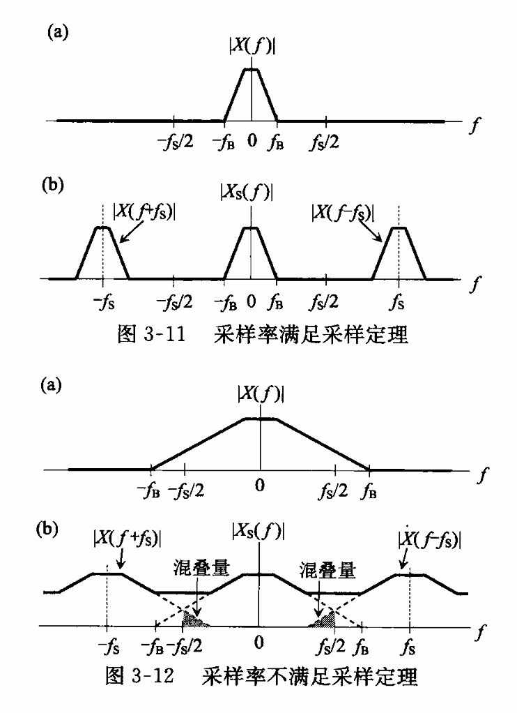

# 频域分析、数字信号处理与傅里叶变换迷思

> [!NOTE]
> 这是一份阶段性学习反思。文中的“当前理解”不代表已经得到严格证明；尚未解决或需要核实的内容统一列为问题。

## 我究竟在困惑什么

高密度的专业术语、数学知识以及工程应用之下的学习困境以及思路整理。

数字图像在计算机中的储存方式很容易理解，即多维向量。但这一部分知识的重点在于如何利用各种仪器从自然界中获取信息并以数字信号的形式保存下来。换句话说，可以理解为：我们见到的各种数字信号，是如何被获取、保存以及传递的？

## 目前建立起来的知识主线

这张图目前只是我的学习地图。真正卡住我的地方，主要集中在“数学模型如何对应物理过程”和“傅里叶变换究竟在解决什么问题”这两处。

## 一、冲激函数：数学模型与采样之间是什么关系

### 当前理解

数字信号的获取，这部分知识来自于最近在看的课本《简明数字信号处理》。

冲激函数与目标函数卷积（相乘再求和），所得的值仍然为目标函数本身。

### 尚未解决的问题

- **Q1：既然已经知道目标函数本身，为什么还要与冲激函数再进行一次卷积？**
- **Q2：这个等式只是数学推导工具，还是在说明实际采样结果一定能够保留原信号？**
- **Q3：为什么“发出一个信号”就可以获得另一个信号？“采样”中的“采”在物理上究竟做了什么？**

> [!WARNING]
> 当前笔记同时涉及“冲激函数与信号卷积”和“冲激串与信号相乘”。这两种运算不能直接混为一谈，后续需要分别核对它们的定义和作用。

## 二、傅里叶变换：我把它理解成了什么

### 当前理解

这部分在书里看过很多次，其实可以粗略理解为一种拟合手段：如何获得一个未知连续或离散函数，或者说隐函数的数学表达式。傅里叶变换试图解决的，就是这个问题。

之前在漫士沉思录里看到的解释非常有用，可以将傅里叶变换类比到向量的坐标分解中去。向量基坐标要求必须正交，以免分解时产生重复；而傅里叶变换里的各个正余弦函数易证得相正交：正弦同频率乘积积分大于零，不同频率乘积积分为零，余弦同理；正余弦彼此之间无论是否同频率，其乘积积分都为0。后续求系数也是根据正余弦的正交性求得的。

书中略过了傅里叶变换为什么可以拟合任意周期函数的证明，在可行的前提下直接开始了如何分解的数学推导。限于笔者精力有限，无力继续深入学习，此处也暂时从略。

总之，经过一系列推导后，我们可以求得任意周期函数的傅里叶系数，将时域函数映射到频域。至于非周期函数，则采取将其视作周期函数，再令周期趋于无穷大的方式进行映射。

### 尚未解决的问题

- **Q4：“拟合”是不是理解傅里叶变换最准确的词，还是更应该称为“换一组基来表示同一个信号”？**
- **Q5：傅里叶级数能够表示哪些周期函数？这里需要满足哪些条件？**
- **Q6：从周期函数的离散谱线过渡到非周期函数的连续频谱时，求和为什么会变成积分？**

## 三、采样定理：数学相乘如何变成物理测量

### 当前理解

这里想谈谈采样定理。采样定理的具体证明仍然非常复杂，首先写采样吧。

采样是通过发射冲激函数实现的。冲击函数的独特特性使得其与目标信号相乘后，得到幅值为原信号对应值的新冲击信号。

所谓相乘是数学定义，但采样是需要在物理当中实现的事，所以问题在于：物理层面如何实现“相乘”二字？问了老师，老师讲这涉及到另一个领域，大体上可以通过电、光电两种途径实现，光电科学与技术这个专业会研究这些东西。但仍然限于时间精力，笔者没有继续深入学习。

总之，经过诸多科学论证，我们可以通过上述函数实现采样。而书中对于采样所得信号的频谱进行了数学推导，结论是采样信号的频谱由原信号频谱叠加而成，且分布在原信号频率的整数倍处。也因此引出了采样定理和混叠的概念。

采样频率过小的情况下，会产生如图所示的频谱混叠。

奈奎斯特采样定理指出，如果连续信号的频率带宽为 $f$，则采样频率必须不低于 $2f$。换句话说，用 $2f$ 以上的频率进行采样，理论上讲可以无损复原出原信号。

### 已经得到的线索

> [!NOTE]
> 根据老师的回答，实际采样可以通过电学或光电途径实现。数学中的冲激串是对测量时刻和采样行为的理想化描述，不等于实验设备真的发出了理想的狄拉克冲激。

### 尚未解决的问题

- **Q7：真实传感器如何在一个有限时间窗口内取得信号值？**
- **Q8：采样电路中的开关、保持器和模数转换器分别起什么作用？**
- **Q9：为什么时域采样会使原频谱在频域中周期复制？**
- **Q10：满足奈奎斯特条件只是理论上的最低要求，实际系统为什么还需要留出余量并先做抗混叠滤波？**
- **Q11：这里的 $f$ 应该指最高频率、带宽，还是奈奎斯特频率？这些概念需要进一步区分。**

## 问题索引

| 编号 | 问题方向 | 当前状态 |
|---|---|---|
| Q1–Q3 | 冲激函数、卷积与采样的物理含义 | 待查证 |
| Q4–Q6 | 傅里叶表示的准确含义与成立条件 | 待系统学习 |
| Q7–Q8 | 传感器、采样保持和模数转换 | 待了解工程实现 |
| Q9–Q11 | 频谱复制、奈奎斯特条件与抗混叠 | 正在学习 |

## 下一步

- [ ] 分清“与冲激卷积”和“与冲激串相乘”分别表示什么。
- [ ] 查清采样保持电路和模数转换器的基本工作过程。
- [ ] 用一个单频正弦波手算采样后的序列。
- [ ] 用图示推导采样后频谱为什么周期复制。
- [ ] 区分最高频率、带宽、采样频率和奈奎斯特频率。
- [ ] 回头修正本文中已经确认不准确的表述，并记录理解变化。

以后可以放在这里的补充材料

- 较长的公式推导；
- OpenCV或Python实验代码；
- 与正文关系不大的教材摘记；
- 已经解决的问题及其详细证明。

## 来源

- 《简明数字信号处理》；
- 漫士沉思录中关于傅里叶变换与向量分解的讲解；
- 数字图像处理课程课堂内容；
- 向老师询问采样物理实现后得到的口头说明。
